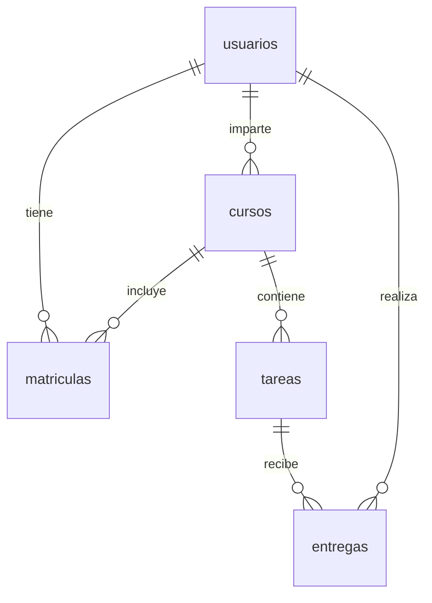

# Base de datos

PostgreSQL 15 en el contenedor `crisma_db`, base de datos `danet`.

## Esquema



```sql
CREATE TABLE usuarios (
  id            SERIAL PRIMARY KEY,
  email         VARCHAR UNIQUE,
  password_hash VARCHAR,
  nombre        VARCHAR,
  role_id       INT
);

CREATE TABLE cursos (
  id          SERIAL PRIMARY KEY,
  nombre      VARCHAR,
  profesor_id INT REFERENCES usuarios(id)
);

CREATE TABLE matriculas (
  id        SERIAL PRIMARY KEY,
  alumno_id INT REFERENCES usuarios(id),
  curso_id  INT REFERENCES cursos(id)
);

CREATE TABLE tareas (
  id            SERIAL PRIMARY KEY,
  curso_id      INT REFERENCES cursos(id),
  titulo        VARCHAR,
  fecha_entrega DATE
);

CREATE TABLE entregas (
  id            SERIAL PRIMARY KEY,
  tarea_id      INT REFERENCES tareas(id),
  alumno_id     INT REFERENCES usuarios(id),
  archivo_url   VARCHAR,
  fecha_entrega TIMESTAMP
);
```

Los ficheros entregados se guardan en `/mnt/TFG_CRIMSA/uploads`; la tabla `entregas` solo almacena su ruta.

## Acceso

```bash
docker exec -it crisma_db psql -U Crisma -d danet
```
