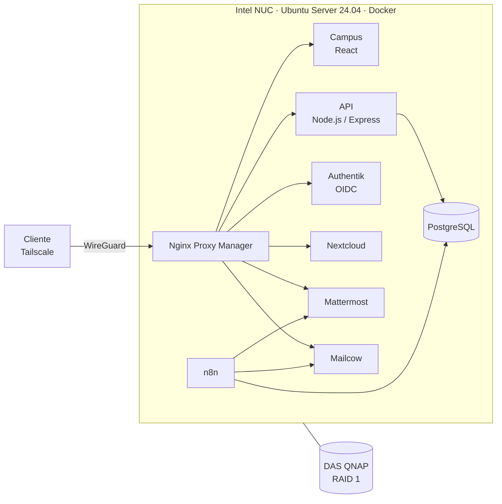

# Ibis Campus

Plataforma educativa autoalojada: un campus virtual propio (React + Node.js) integrado con correo, almacenamiento en la nube, chat y SSO, desplegada íntegramente con Docker sobre un servidor físico y accesible solo a través de VPN.

Proyecto de Fin de Grado del ciclo ASIR (2026), desarrollado por **David Coca** y **Gerard Conesa**.

> El servidor se desmanteló al finalizar el proyecto. Este repositorio recoge la arquitectura, la configuración de cada servicio, los scripts de operación y los problemas resueltos durante el despliegue.

---

## Arquitectura

| Servicio | Acceso | Contenedor | Función |
|---|---|---|---|
| Campus virtual | `ibis.local` | `crisma_front`, `crisma_back` | Aula virtual: cursos, tareas y entregas |
| Authentik | `auth.ibis.local` | `authentik-server` | Proveedor de identidad (OIDC) |
| Nextcloud | `nube.ibis.local` | `nextcloud-mailcow` | Almacenamiento y carpetas por asignatura |
| Mattermost | `chat.ibis.local` | `sphynxchat` | Chat por canales y asignaturas |
| Mailcow | `mail.ibis.local` | `*-mailcow` | Correo institucional (SMTP/IMAP, SOGo) |
| n8n | `:5678` (solo VPN) | `n8n_ibis` | Flujos de automatización |
| PostgreSQL | interno | `crisma_db` | Base de datos del campus |
| Nginx Proxy Manager | `:81` (solo VPN) | `global-proxy` | Proxy inverso y terminación TLS |

En total, más de 25 contenedores. El sistema operativo y Docker residen en el SSD interno; los datos persistentes, en el DAS montado en `/mnt/TFG_CRIMSA`.

---

## Decisiones de diseño

- **Sin exposición a Internet.** El router no tiene puertos abiertos. Todo el acceso remoto pasa por Tailscale (WireGuard).
- **Un único punto de entrada.** Nginx Proxy Manager enruta por nombre de host hacia cada servicio. El resto de contenedores se comunica por redes Docker internas.
- **Identidad centralizada.** Authentik actúa como IdP OIDC para el campus y Nextcloud. Mattermost Team Edition no admite OIDC genérico, así que sus cuentas se aprovisionan por API desde el mismo origen de usuarios.
- **Automatización con n8n.** Alta de buzones y cuentas de chat, notificaciones de material nuevo y moderación básica del chat.
- **Operación con scripts propios.** Monitorización de contenedores, comprobación de la base de datos, backups semanales y alertas por Telegram ([`scripts-bash/`](scripts-bash)).

---

## Problemas resueltos

Los que más tiempo costaron. El detalle está en cada documento enlazado.

| Problema | Solución | Documento |
|---|---|---|
| Authentik enviaba el nombre de usuario con un prefijo que no coincidía con las cuentas de los servicios | Corrección de los registros afectados con un `UPDATE` directo sobre la base de datos de Authentik | [Authentik](05-servicios/00-authentik-sso.md) |
| Login SSO de Nextcloud | Configuración de la app `oidc_login` contra Authentik y ajuste de `trusted_domains` | [Nextcloud](05-servicios/01-nextcloud-almacenamiento.md) |
| Mattermost Team Edition sin OIDC genérico | Alta masiva de usuarios mediante la API REST | [Mattermost](05-servicios/02-mattermost-chat.md) |
| Mensajes de Mattermost que solo aparecían al recargar | Cabeceras de WebSocket en el proxy | [Nginx](02-infraestructura/05-nginx-proxy.md) |
| Mailcow y el proxy compitiendo por los puertos 80/443 | Mailcow movido a 8181/8444 y publicado a través del proxy | [Mailcow](05-servicios/03-mailcow-correo.md) |
| Bloqueo del acceso remoto al activar UFW | Acceso físico y regla para `tailscale0` antes de reactivar el firewall | [Firewall](02-infraestructura/04-firewall-ufw.md) |
| Errores de escritura en Nextcloud y Mattermost | Propietario de los volúmenes ajustado al UID de cada imagen (33 y 2000) | [Troubleshooting](08-troubleshooting/00-problemas-por-servicio.md) |
| La carpeta Samba no aparecía en la red | El router del centro bloqueaba NetBIOS; acceso directo por IP de Tailscale | [Samba](02-infraestructura/06-samba-almacenamiento.md) |

---

## Contenido del repositorio

| Carpeta | Contenido |
|---|---|
| [`01-guias-instalacion`](01-guias-instalacion) | Requisitos, preparación del servidor y orden de despliegue |
| [`02-infraestructura`](02-infraestructura) | Hardware, Ubuntu, Docker, Tailscale, UFW, proxy y Samba |
| [`03-backend`](03-backend) | API Node.js/Express, esquema de base de datos y autenticación |
| [`04-frontend`](04-frontend) | Aplicación React/Vite |
| [`05-servicios`](05-servicios) | Authentik, Nextcloud, Mattermost, Mailcow, n8n y TLS |
| [`06-seguridad`](06-seguridad) | Modelo de seguridad, auditoría, secretos y certificados |
| [`07-automatizacion`](07-automatizacion) | Monitorización, backups, alertas y cron |
| [`08-troubleshooting`](08-troubleshooting) | Errores encontrados y diagnóstico |
| [`09-referencias`](09-referencias) | Comandos y enlaces de consulta |
| [`scripts-bash`](scripts-bash) | Scripts de operación |

Los valores sensibles del repositorio son marcadores. `100.x.y.z` representa la IP de Tailscale del servidor y [`.env.example`](.env.example) recoge las variables necesarias.

---

## Autoría

**David Coca.** Infraestructura y administración de la plataforma: despliegue y configuración de todos los contenedores Docker, desde la interfaz y por terminal; integración SSO con Authentik y OIDC en los servicios; gestión de accesos, ficheros y control del servidor; red y seguridad; backups, scripts de operación y tareas programadas.

**Gerard Conesa.** Aplicación del campus: frontend en React (diseño visual, interfaz y vistas) y API en Node.js/Express, incluida la autenticación con JWT.

---

## Qué cambiaría en una segunda versión

- **Sesión del campus.** Guardar el JWT en una cookie `HttpOnly` y `Secure` en lugar de `localStorage`, para reducir el impacto de un XSS.
- **Docker y UFW.** Los puertos publicados por Docker no pasan por las reglas de UFW. Publicaría solo en la IP de Tailscale (`100.x.y.z:puerto:puerto`) o filtraría en la cadena `DOCKER-USER`.
- **Backups.** El RAID 1 protege frente a un fallo de disco, no frente a borrados o ransomware. Añadiría copias cifradas fuera del servidor con restic o borg.
- **Imágenes.** Versiones fijadas en lugar de `latest` y escaneo con Trivy.
- **Frontend.** Servir el build estático con nginx en lugar del servidor de desarrollo de Vite.
- **Nombres y certificados.** Usar `home.arpa` (o un subdominio real) en vez de `.local`, que choca con mDNS, y una CA interna o los certificados de Tailscale en lugar de autofirmados.
- **Visibilidad.** Centralizar logs y alertas con Wazuh o Grafana + Loki, además del bot de Telegram.
